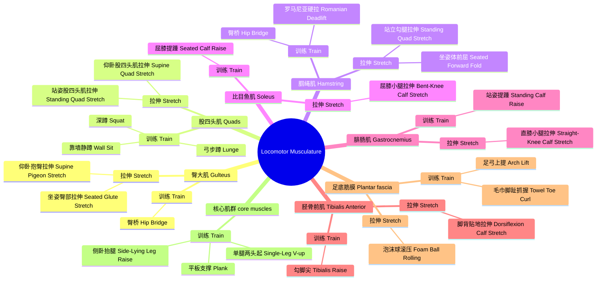

<mark>====无论是日常对肌肉的强化训练还是运动完之后的拉伸放松都是很重要的，上面给出的是本人训练的一些经验总结，下面是对以上训练和拉伸动作的指南方便各位借鉴训练以及制定合理的训练课程计划安排

==图示动作指导==

* 臀桥

> 1. 仰卧在地面，屈膝，双脚踩实，双脚和髋同宽，脚跟离臀部大概一掌远，手臂放在身体两侧，我一般是贴地的。
> 2. 先收紧核心，不是把肚子蜷起来哈，肋骨往下收，不要塌腰，就是保持腰板挺直。
> 3. 用脚跟发力，把臀部向上顶起来，直到肩、髋、膝盖在一条直线上。
> 4. 到最高点用力夹紧臀部，保持 2～3 秒差不多就行
> 5. 缓慢控制下放，臀部不要直接砸地，不然受伤你不就炸了吗。

* 仰卧抱臀拉伸

> 1. 仰卧在垫子上，没有垫子在操场随便找块足球场地也行，背部贴紧地面，一条腿屈膝，另一条腿自然伸直放在地上。
> 2. 双手环抱住屈膝腿的膝盖，轻轻往胸口方向拉动。
> 3. 屁屁和腰部给我贴好地面了呀，感受臀部后侧以及臀外侧的拉伸感，就是屁股有感觉的意思，
> 4. 维持这个拉伸姿势，保持 20 到 30 秒左右就行，然后换另外一只脚。

* 坐姿臀部拉伸

> 1. 坐姿在垫子上，也可以直接坐地上，一条腿伸直，另一条腿屈膝跨过伸直的腿，脚掌踩在伸直腿外侧。
> 2. 腰背挺直，身体可以轻轻向屈膝腿一侧慢慢扭转，不用太快小心闪到腰哈，
> 3. 依旧屁股和贴地放直的腿紧贴大地，感受屈膝一侧臀部外侧的牵拉感，有点酸胀感就行，不要搞太猛，
> 4. 维持 20～30 秒，然后换脚就行。

* 弓步蹲

> 1. 站立，一脚向前迈出一大步，屈膝下蹲，前后两条腿都弯成大约 90 度就行。
> 2. 前侧膝盖对准脚尖，尽量不要超过脚尖，后侧膝盖不要砸地，不然成膝盖活爹了，受伤就老实了。
> 3. 过程上身保持直立，核心收紧，重心稳定，这里的话大腿前侧感觉多一点就行
> 4. （也可以加个跳跃，弓步跳，不过这个膝盖可以不用弯曲那么多）

* 深蹲

> 1. 这个比较简单常见说一下注意事项吧：双脚分开与肩同宽或略宽，脚尖微微外展，不要内扣哈，收紧核心，腰背挺直，不用太快，额......还有尽量保持稳定哈，脚跟贴地，站不稳买502胶水粘上得了

> 【这个就是可能比较累大腿，一般12-20一组就行，反正自己看着办，不要勉强自己好吧，练就完了】

> 【为啥这里没有蛙跳呢？是因为蛙跳对膝盖的损伤可能会相对大一点，后面进阶可以适当的做一下，这里就不安排了好吧】

* 靠墙静蹲

> 1. 这个也说一下注意事项：这个是静态训练哈，所以身体不要像小蛇一样动来动去，后背贴紧墙面，双脚向前迈出一步左右，双脚与肩同宽，脚尖微微朝外就行，然后主要是保持两个90°，腰板和大腿呈90°，大腿和小腿呈90°

> 【这个的话，大腿的酸胀感会比较明显，也不要勉强自己好吧，刚开始可以1-2分钟左右一组，后面有实力可以往上适当加点，必须有毅力，蹲就完了】

* 站姿股四头肌拉伸

> 1. 站稳，一只手扶住一个地方保持身体稳定，如果你是木头人可以省略找东西扶住这一步好吧
> 2. 另一只手抓住同侧脚踝，把脚跟轻轻拉向臀部。
> 3. 膝盖尽量并拢，就是不要像手撕鸡翅那样把脚往外掰好吧，还有，骨盆不要往前顶，腰背要保持直立。
> 4. 感受大腿前侧牵拉感，就是会比较紧绷，也不要拉太过头了，有拉伸感就差不多了知豆不。
> 5. 保持 20 到 30 秒就差不多了就缓慢松开，换另一侧。

* 俯卧股四头肌拉伸

> 1. 这个跟前面站姿股四头肌拉伸动作是一样的，但是省略了第一步，这个找个垫子或者草地之类的趴下就行，身体紧贴地面，然后步骤参考上面，拉伸感受也是一样的。

* 罗马尼亚硬拉

> 1. 双脚与髋同宽，就是正常站立脚的宽度就差不多了，脚尖微微外展，双手握住杠铃或哑铃，或者找一些重一点的东西，放在大腿前侧，不用完全贴住，膝盖保持微弯，这个弯曲角度全程尽量不变。
> 2. 收紧核心、腰背平直，不要弯腰太多啊！！！！以髋关节为轴，臀部向后推，也不要推太多搞得你前凸后翘的，又搞笑还容易受伤，上半身跟着慢慢俯身，杠铃在大腿前往下滑。
> 3. 下放到大腿后侧有明显牵拉感就停，不要强行下很深，腰部不受力，臀部和大腿后侧有牵拉的酸胀感就OK，再强调一遍：不要弯腰驼背！
> 4. 发力把髋向前送，夹紧臀部，回到直立姿势，下放吸气，起身呼气。
> 5. 【全程小腿尽量垂直地面，不要往前跪，不要用腰发力】

* 站立勾腿拉伸

> 1. 跟前面站姿股四头肌拉伸一样动作，这里补充一下拉伸时间吧，一般单边腿拉伸20-40秒左右就行，做1到2组就行，注意不要拉太猛导致有刺痛感，容易拉伤知豆不。

* 坐姿体前屈

> 1. 找一个地方坐下，双腿伸直并拢，腰背先挺直，就是搞一个直角出来先。
> 2. 髋部折叠，上身慢慢向前俯，手可以去够脚尖，感受大腿后侧腘绳肌的拉伸感，小腿后侧也会有一点感觉，就是平时体测的坐位体前屈。
> 3. 保持背部平直，不要弓背强行压，可以采用轻压多次的办法。

* 屈膝提蹱

> 1. 找地方站稳，双手扶墙保持平衡，双脚与髋同宽，膝盖保持微微弯曲，注意是微微弯曲就好，别搞前凸后翘，全程尽量不要伸直。
> 2. 前脚掌发力，把脚跟尽量抬高，提上去之后可以稍作停顿，大概1~2秒就行，然后感受小腿的挤压感。
> 3. 缓慢把脚跟放下去，不要砸地啊，做的过程中注意膝盖角度固定不动，只用脚踝活动，是提蹱，不是蹲起！
> 4. 这个的话主要练小腿深层的比目鱼肌，每组 15～20 次，每次训练活动做 2～3 组就行。

* 站姿提蹱

> 1. 这个屈膝提蹱差不多，就是少了微微屈膝这一步，其他动作照做就行，练小腿表层的腓肠肌的。

* 屈膝小腿拉伸

> 1. 这个动作在跑步圈里非常常见好吧，就是找个墙或者找棵树都行，一只脚脚尖抵住墙面脚后跟着地，另一只脚在后面微微弯曲膝盖。
> 2. 身体慢慢往前倾靠，感受后侧小腿深处的牵拉感，保持20~30秒就行，换腿。

* 站立小腿拉伸

> 1. 这个跟屈膝动作差不多，区别就是这个后面那只腿不用微微弯曲，拉伸感在小腿后侧表层的腓肠肌，依旧前脚尖抵墙，依旧身体前倾，依旧20~30秒。

* 勾脚练胫骨前肌

> 1. 坐稳就行，有条件的坐沙发练都行，两腿腿伸直，脚尖用力往回勾，把脚背朝向自己，勾到底停留个1~2秒左右吧，然后缓慢放松就是一次完成。
> 2. 这个主要练胫骨前肌（胫骨前肌筋膜炎发生地），每组 15～20 次，每次训练课完成2～3 组就行。

* 脚背贴地拉伸法

> 1. 先来个跪坐姿势，就是吃寿司那种就好，脚背贴在地面，脚趾朝后。
> 2. 身体可以缓慢向后坐，重心慢慢压向脚跟，感受脚背、小腿前侧牵拉，保持 20 到 30 秒就好。
> 3. 缓慢起身，不要硬压，疼痛就停下，主要拉伸小腿前侧胫骨前肌。

* 足弓上提

> 1. 坐姿或者站立都行，脚跟、脚趾保持贴地，主动把足弓向上拱起，顶到底保持1~2秒左右就行，注意不要踮脚尖，最后慢慢落下完成一组。
> 2. 练足底小肌群，每组 15 次，每次训练课做 2～3 组。

* 脚趾抓握

> 1. 这个就要个小毛巾当道具，玉足踩在毛巾上，脚跟不动保持稳定，用脚趾反复抓拢毛巾再松开，每次抓握保持1~2秒，再缓慢放开完成一次。
> 2. 这个可以锻炼足底肌群，每组 15 次，每次训练课完成2～3 组。

* 平板支撑

> 1. 手肘撑在地面，手肘在肩膀正下方，双腿向后伸直，脚尖点地，收紧核心，身体成一条直线，不要塌腰、不要翘屁股，依旧避免前凸后翘，不要当毛毛虫，不要当小蛇！
> 2. 保持核心、身体、呼吸稳定，刚开始可以坚持1~2分钟，后面有实力可以坚持5分钟以上，建议可以放音乐训练，每次核心训练课做2 ~3组就行。

* 单脚两头起

> 1. 仰卧躺在一个地方，一条腿伸直抬起，同时上半身抬离地面，手去够抬起的腿，稍微停顿一下，再缓慢回落，后背不要完全砸地，做的过程收紧核心，腰贴紧地面，避免腰部代偿发力。
> 2. 每条腿做12~15次左右，两条腿都完成算一组，每次核心训练课做2 ~3次组就行。

* 侧卧抬腿

> 1. 侧躺，下方腿微屈，上方腿伸直，腰背保持平直，上方腿缓慢向上抬，不要翻胯，顶到最上面稍微停一下，再慢慢下放，感受臀部外侧还有核心发力。
> 2. 每侧 12～15 次，两侧都完成一次算一组，每次核心训练课完成2～3 组就行。

---

> 作者PB：1000米2分59秒38  |   800米2分14秒36   |    400米55秒26，（希望能跟各位大佬们一起进步）
> 感谢你的观看，希望可以给你带来帮助！你的关注和支持永远是我创作的动力！
> l以上内容原创，仅代表个人观点，有说得不对的请及时提出，本人定会合理接受建议并及时改进！
> 有问题欢迎在在评论区讨论，注明来因可支持私信投稿私信交流 ，希望各位早日PB！

-------------------------==-@9a70b-blog原创，搬运请注明出处-==---------------------------------------------·····--------------上标上标
