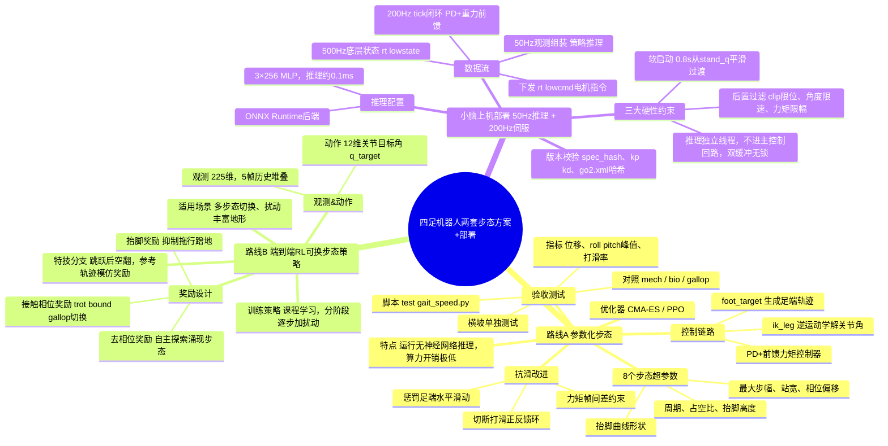

## 一、前提：手写步态的局限

控制器是相位驱动的：一个周期里每腿有支撑相和摆动相，支撑相足端按速度反向平移，摆动相走一条「快抬慢落」的曲线，足端目标经 IK 变成 12 个关节角，加 PD 和重力前馈发到 `rt/lowcmd`。参数靠枚举，比如`mech`、`bio`、`gallop` 三套就是这么调出来的。

仿真里的实测边界：


| 条件          | 结果                                        |
| ------------- | ------------------------------------------- |
| 0.20 m/s 平地 | 10 s 稳，pitch −2°、roll ±1°、dy ±1 cm |
| 0.30 m/s 平地 | 约 5 s 后失速，vt 0.23 → 0.00，打滑累积    |
| 5° 横坡      | 8 s 不翻，横移 94 cm，roll 峰峰 31°        |

没解决/难解决：高速打滑、横坡持续往坡下漂、法向力分配由支撑权重凑。它们有一个共同点——都发生在接触面上。接触模型做不准，调参数就只能靠试。

强化学习，它可以在几千万次试错里，把「什么相位配什么足端速度」穷举出来。

## 二、两个思路

「拿到新步态或新动作」要的是**运动本身**。它可以只是一组参数，或者一条时间轨迹，不需要神经网络上机。

「生成小脑权重，用推理操控机器人」要的是**控制律**。一个网络吃观测、吐关节目标，换掉的正是现在 `_gait_feet_publish` 加 IK 加前馈这一整条链。

## 三、训练环境不能接现有那条 DDS 链路

> 1. 现状架构：仿真（mjpython）、控制器是两个分开进程，靠DDS收发数据。控制器闭环固定200Hz，每帧严格5ms。这套是给**真机验证、实时控制**做的，追求时序对齐、稳定。
> 2. RL训练要求：要收集大概1亿条环境样本才能训好小脑策略。
> 3. 冲突：这套DDS双进程链路最多只能做到200个样本/秒；RL训练需要的采样速度是它的1000倍（3个数量级差距）。
> 4. 结论：**不能拿现在这套DDS闭环来跑训练**。训练单独写一套同进程、向量化并行的MuJoCo环境，不经过DDS，高速采样训练；训完把权重导出来，再放进原来200Hz的控制器里在线推理。训练、推理是两套管线。

训练环境必须进进程内：`mujoco.MjModel` 直接读 `go2.xml`，自己推进物理。新建 `quadruped/rl/env.py`，和 `controller.py` 不互相 import。

硬约束有三。

**机器人模型统一使用项目内这份 `go2.xml`，**RL训练、仿真验证都加载它，不要为适配其他训练框架额外导出一份URDF（RDF = **Unified Robot Description Format，统一机器人描述格式**）；格式转换极易引入质量、惯性等参数偏差，哪怕仅1kg质量误差，重力前馈力矩就会偏差约10N，这类偏差在仿真中不容易暴露，策略在仿真里表现正常，但部署到实体机器人上就会出现失控、打滑、摔倒等Sim2Real失效问题。

**顺序合同写在一处。** 本项目存在CTRL\_LEGS、LEGS、MOTOR\_LEGS三套不同的腿部关节排列顺序，训练侧观测拼接与动作解析、部署侧观测组装和电机指令下发都必须统一导入同一份spec.py来读取顺序定义，禁止在训练、控制器代码里各自硬编码一套顺序，防止索引错位导致机器人四肢动作错乱。

**观测不用 rpy。** 在RL（强化学习）观测输入中不要直接使用欧拉角rpy（横滚、俯仰、偏航角），改用重力矢量（重力方向向量）在机体坐标系（机器人自身坐标系）下的三维投影作为姿态特征，该表示方式在横滚角接近±90°奇点（万向锁，欧拉角失效的奇异位置）不会发生数值跳变，姿态相关信息虽然可以正常计算使用，但严禁将欧拉角送入神经网络。

欧拉角存在万向锁奇点，机器人姿态平滑变化时欧拉角数值可能突然跳变，不满足神经网络对观测连续性的要求，网络很难学到稳定正确的姿态策略，所以不能直接喂给网络

`spec.py` 大概长这样：

> **整个项目唯一的观测、动作、时序参数定义文件**，训练侧、控制器侧统一导入它，保证两边维度、缩放、顺序完全对齐

```python
# quadruped/rl/spec.py —— 观测与动作的定义只有这一份
OBS_ITEMS = (
    ("gyro",      3, 0.25),   # 机体系角速度 rad/s
    ("grav",      3, 1.00),   # R^T · [0,0,-1]
    ("cmd",       3, 1.00),   # vx, vy, wz
    ("q_err",    12, 1.00),   # q - STAND_Q，顺序 CTRL_LEGS
    ("dq",       12, 0.05),
    ("act_prev", 12, 1.00),   # 上一帧动作，压抖动
)
HIST = 5                                  # 堆 5 帧，对抗延迟
OBS_DIM = sum(n for _, n, _ in OBS_ITEMS) * HIST   # 45 × 5 = 225

ACTION_SCALE = 0.25                       # q_target = STAND_Q + 0.25 · a
CTRL_DT = 0.02                            # policy 50 Hz
PHYS_DT = 0.002                           # 物理 500 Hz，decimation 10
```

> 1. **缩放系数（第三个数字）**：把不同量级的观测缩放到相近区间，方便神经网络训练；角速度 gyro 数值偏大，所以乘 0.25 压缩。
> 2. **`grav`重力投影**：就是前面说的替代欧拉角的姿态特征，3 维向量，无万向锁奇点。
> 3. **`q_err`关节误差**：当前关节角度减去默认站立姿态`STAND_Q`，网络学习 “偏离站立姿态多少”，而不是直接学绝对角度。
> 4. **`act_prev`上一帧动作**：给网络看到上一轮输出，网络会主动避免动作剧烈跳变，抑制腿部抖动。
> 5. **HIST=5 观测堆叠**：RL 只能看到当前一帧会有延迟问题，把连续 5 帧拼在一起给网络，网络能预判状态变化，对抗延迟。
> 6. **decimation=10**：仿真物理跑很快（500Hz），不需要每一步都跑神经网络策略；每算 10 次物理、再跑一次策略推理，兼顾精度和速度。
> 7. **ACTION\_SCALE**：网络输出的原始动作 a 一般在 [-1,1]，乘以 0.25 之后，再叠加站立基准角，得到合理的关节目标位置，限制动作幅度，防止动作过猛。

执行器在训练环境里要自己实现，别直接用 xml 的 position actuator：

`position actuator：MJCF (xml) 内置的位置型执行器，MuJoCo 自带的位置伺服。

**不要依赖 xml 里写死的内置位置伺服**，在仿真环境代码里手动写 PD 力矩控制，保证仿真 PD 和真机电机 PD 完全一致。`

```python
tau = kp * (q_des - q) + kd * (0.0 - dq)      # kp=100, kd=1.5，与真机同源
data.ctrl[:] = tau
```

> * `tau`：关节输出力矩（torque）
> * `kp`：比例增益（刚度），`kd`：微分增益（阻尼）
> * `q_des`：目标关节角度；`q`：当前关节角度；`q_des - q` = 角度误差
> * `dq`：当前关节角速度；`0.0 - dq` 代表目标角速度是 0，只做阻尼抑制速度
> * 公式就是**PD 力矩伺服**：根据角度误差算出力矩，再赋值给 MuJoCo 的控制输入`data.ctrl`

kp（比例增益，控制伺服刚度）=100、kd（微分增益，控制阻尼）=1.5 是针对这台四足机器人真机标定实测得到的参数，也就是 KP_REAL、KD_REAL；如果直接套用网上教程常用的 kp=20、kd=0.5 这种偏小的 PD 参数，仿真环境里的电机伺服会变得很软，强化学习训练出来的策略会依赖这种仿真里虚构的柔顺缓冲效果，最终造成仿真中机器人可以稳定站立，但部署到真实硬件上时，真机伺服刚度更高、没有这种软缓冲，就会出现抬腿无力、动作失效的 Sim2Real（仿真到真机迁移）失败问题。

## 四、路线 A：让 RL 去搜步态参数

该方案将四足机器人的动作空间（智能体可调变量集合）压缩为周期（步态循环总时长）、占空比（支撑时间占比）、抬脚高度（足部最大离地高度）、最大步幅（单腿前后最大迈步距离）、站宽（左右腿横向间距）、四腿相位偏移（四条腿迈步时序差）、抬脚曲线形状（足端摆动轨迹轮廓）共 8 个步态超参数，使用 CMA-ES（无梯度进化优化）或 PPO（近端策略强化学习）在低维空间内搜索最优步态参数，训练收敛（指标不再提升）后得到一组 GaitParams（步态参数结构体），运行时由 foot_target ()（生成足端目标位置）生成足端目标轨迹，再通过 ik_leg () 逆运动学 IK（足端位置反解关节角）解算关节目标角度，最后送入带前馈（提前补偿力矩）的 PD 力矩控制器（比例微分伺服）驱动机器人，推理阶段无需神经网络实时输出动作，计算开销极低。

> 1. **参数化步态**：不直接输出关节角度，用一组少数可控参数（周期、占空比等）定义足端轨迹的步态框架。
> 2. **动作空间**：智能体可以输出、调整的变量集合，这里是8个步态参数，区别于直接输出关节角度的高维动作空间。
> 3. **周期**：一次完整步态循环的总时间。
> 4. **占空比**：支撑相（脚落地支撑）占整个步态周期的比例，决定抬腿时间长短。
> 5. **抬脚高度**：摆动相时足部离地的最大高度。
> 6. **最大步幅**：单腿一次迈步前后方向的最大移动距离。
> 7. **站宽**：机器人左右两腿之间的横向距离，影响侧向稳定性。
> 8. **四腿相位偏移**：四条腿步态时序的错开关系，决定步态模式（小跑、爬行等）。
> 9. **抬脚曲线形状**：足端在空中摆动轨迹的插值轮廓（正弦、贝塞尔曲线等）。
> 10. **foot\_target()**：步态生成函数，输入步态参数，输出每一时刻足端的期望3D位置。
> 11. **ik\_leg() 逆运动学IK**：已知足端目标位置，反求腿部各个关节目标角度的计算。
> 12. **PD控制**：比例-微分伺服，根据角度误差和误差变化率计算关节力矩。
> 13. **前馈**：根据目标轨迹提前补偿期望力矩，提升轨迹跟踪速度、减小滞后。
> 14. **CMA-ES**：协方差矩阵自适应进化策略，无梯度黑盒优化算法，适合搜索步态参数。
> 15. **PPO**：近端策略优化，主流强化学习算法，可在低维参数空间做策略搜索。
> 16. **收敛**：优化过程中指标（稳定性、速度）不再明显提升，找到较优参数。
> 17. **GaitParams**：存放整套步态参数的数据结构。
> 18. **make\_gait()**：步态生成入口函数，接收GaitParams，持续输出足端轨迹。
> 19. **回归成本为零**：部署运行时不再需要神经网络前向推理，只靠参数化公式计算，无网络推理开销。

奖励这么写：


| 项             | 形式                            | 权重 |
| -------------- | ------------------------------- | ---- |
| 前进速度跟踪   | `exp(-(vx - vx_cmd)**2 / 0.04)` | 1.5  |
| 横向、偏航漂移 | `-(abs(vy) + abs(wz))`          | 0.5  |
| 姿态           | `-(roll**2 + pitch**2)`         | 0.6  |
| 机身高度       | `-(h - 0.27)**2 / 1e-3`         | 0.3  |
| 足端打滑       | 支撑相足端水平速度平方          | 0.8  |
| 关节力矩       | `sum(abs(tau))`                 | 1e-3 |
| 力矩帧间差     | `sum(abs(tau_t - tau_prev))`    | 1e-4 |

该方案重点针对打滑问题，0.30 m/s下会出现打滑→速度环放大步幅→足部扫动更快→打滑加剧的正反馈（自激恶化循环），通过在奖励函数中惩罚足端水平滑动来切断该正反馈，加入力矩帧间差项（和\_slew\_tau力矩限幅滤波作用一致，只是交由优化器自主权衡）；

验收使用`test/gait_speed.py`脚本，对比位移、roll（横滚角）/pitch（俯仰角）峰值、打滑率指标，与mech（机械步态）、bio（仿生步态）、gallop（疾驰步态）基准对照，横坡工况单独测试（当前横移94 cm，优化效果直观可观测）；

本次优化目标不一定产出全新步态，也可以是抗滑能力更强的步态参数，相比人工遍历duty（占空比）、站宽这类参数需要数天，自动搜索能把调参耗时压缩至小时级别。

## 五、路线 B：学一个会换步态的策略

真正的端到端策略，动作是 12 维关节目标（直接输出12个关节期望角度）。

观测 225 维，就是前面 `spec.py` 那六项堆 5 帧（历史时序观测，堆叠5帧状态）。动作 `a ∈ R¹²`，`q_target = STAND_Q + 0.25·a`（以站立基准姿态叠加缩放后的策略输出作为目标关节角），再 clip 到关节限位（后腿大腿用 `LIMITS_REAR_THIGH`，前限更松）。

奖励在路线 A 的基础上加两样。

**抬脚。** 只给前进奖励，策略会学出「蹭地拖行」——脚不离地，靠摩擦往前挪，速度指标能过，姿态一塌糊涂。加摆动相足端离地高度、腾空时间，把脚逼起来（约束足端轨迹，强制抬腿摆动）。

**接触序列。** 想让它出指定步态，就把目标接触相位喂进奖励：

```
r_contact = -sum(abs(c_i - c_hat_i) for i in range(4))
```

`c_hat` 由内时钟给：对角相位是 trot（对角小跑），前后两对是 bound（弹跳步态），四腿错相是 gallop（疾驰步态）。同一套奖励换模板就换步态，跟你现在 `make_gait` 的三档一一对上。想让它自己发现步态，就把这一项删掉、只留抬脚约束，代价是收敛慢（优化稳定更慢），也更容易落到奇怪的解上（陷入局部最优、异常步态）。

课程学习（分阶段渐进式训练）不能省：指令从 0 开始，能站住 5 s 再加 0.1 m/s；平地走稳了再加 ±2 cm 起伏和摩擦随机；最后加侧向推力。一步到位地训 0.6 m/s，前面几百万步全是摔（直接高速训练极易持续摔倒，很难收敛）。

**跳跃、后空翻这类动作另走一条路。** 从零搜奖励太贵，用参考轨迹加模仿奖励（轨迹模仿学习）：`pose_sequence`（姿态序列）已经有关键帧插值，把关键帧扩成带时间戳的轨迹，网络学跟踪，落地缓冲单独给奖励。`peak_z`（足端/机体峰值高度）是现成的高度量尺。

## 六、小脑上机：50 Hz 出目标，200 Hz 执行

部署时的数据流：




策略 50 Hz 出目标，200 Hz 回路只做插值、限速、PD 和前馈：

**推理不进主回路。** `embodied/__init__.py` 里提到：一次推理几百毫秒，塞进回路即丢帧、腿悬空。策略跑独立线程（策略推理和伺服控制线程解耦），`_tick` 读一个引用赋值的双缓冲（双缓冲：两块内存，一个写新策略输出、一个供控制回路读取，单写单读不需要锁，避免线程竞争阻塞）。要把策略放独立进程，`launcher.py` 的多进程模型即可使用。

**软启动。** 从 `stand_q`（站立基准姿态）用 0.8 s 插值滑进策略输出。`_tau_ff`（前馈力矩计算函数）里那段 `TAU_ARM_ERR`（姿态误差触发力矩衰减）斜降逻辑是同一个问题的手写版：实际角和目标差得远的时候，前馈必须退，否则腿朝莫名其妙的方向蹬一下。

**后置过滤。** 策略输出的目标先过三道：关节限位 clip（截断到硬件允许的角度范围）、关节角每帧限速（0.05 rad/帧，200 Hz 下等于 10 rad/s）、力矩限幅（限制最大输出力矩，防止冲击）。`selftest()`（自检函数）那一套 `_check_*`（各项状态安全校验接口）全部保留。

```
# mode == "policy" 时 _tick 里做的事
tgt = self._policy_target if self._policy_target is not None else self._hold_q
tgt = np.clip(tgt, self._q_lo, self._q_hi) # 关节角度限位裁剪
tgt = self._slew_q(tgt, step=0.05) # 角度斜率限速，平滑突变
self._publish(tgt, tau=self._tau_ff(tgt)) # 下发目标角度+前馈力矩
```

推理后端用 ONNX Runtime（ONNX推理运行库，轻量化神经网络推理引擎）就够。三层 256 的 MLP（多层感知机，全连接神经网络），前向 0.1 ms 以内，Go2 机载那点算力完全吃得下，瓶颈在 Python 的 GIL（全局解释器锁，Python多线程CPU调度限制）和线程调度，不在网络本身。

权重文件里要存三样东西：`spec_hash`（观测配置哈希值，标记观测空间定义版本）、`kp/kd`（PD控制比例、微分增益）、`go2.xml` 的 hash（机器人URDF模型文件哈希）。

观测向量（网络输入向量，每一位对应一项机器人感知信息）只要修改任意一个字段，旧模型权重（神经网络学到的参数）就必须废弃，因为输入通道语义（每个位置代表的物理量）、观测归一化统计量（均值标准差，用来把观测缩放到合适区间）全部错位，策略映射关系彻底失效，无法正常推理。。

## 七、sim2real 清单


| 项       | 范围                            | 说明                         |
| -------- | ------------------------------- | ---------------------------- |
| 机身质量 | ±10%                           | 加负载、换电池都会变         |
| 地面摩擦 | 0.4 ～ 1.2                      | 瓷砖、地毯、水泥差别很大     |
| 电机强度 | ±15%                           | 电池电压从 32 V 掉到 28 V    |
| 控制延迟 | 1 ～ 3 帧                       | DDS 加驱动器，按 5～15 ms 估 |
| IMU 噪声 | 陀螺 0.02 rad/s、加计 0.2 m/s² | 起点值，用真机静置数据标定   |
| 地形     | 摩擦随机 + ±2 cm 起伏          | 5° 坡那组要单独验           |
| 观测噪声 | 关节角 0.01 rad、角速度 0.5     | 训练时加，推理时不加         |

名义值（仿真基准参数）直接读取`simulate_python/config.py`中的`REALISM`（真实感参数组），该配置已经内置关节摩擦（关节转动阻尼损耗）、力带宽（力矩输出响应上限）、编码器噪声（关节角度传感器随机误差）、指令延迟（控制指令下发滞后）的仿真模型，只需要把固定数值修改为参数化随机采样，实现域随机化训练。

有一条极易被忽略的关键点：释放mcf（宇树底层运动控制框架）之后，小脑（自研的策略伺服控制层）是唯一的平衡层；开启`ReleaseMode`（裸机释放模式）时，宇树原生第二层MPC（模型预测控制）+WBC（全身控制）整套控制链路直接停用，站立静差（稳态姿态偏移误差）从4.12°降到0.64°是重新整定参数后的效果，策略本身必须具备独立稳定站立能力，不能依赖底层原有控制框架兜底容错。

## 八、算力：Mac 上没有 CUDA


| 方案                         | 可行性   | 说明                                                                            |
| ---------------------------- | -------- | ------------------------------------------------------------------------------- |
| Isaac Lab / legged_gym 本地  | 不行     | 要 NVIDIA 加 Linux                                                              |
| MJX 本地（mujoco-mjx + JAX） | 能跑，慢 | 和 `go2.xml` 同一份模型，Python 3.10 兼容，Apple Silicon 走 CPU，百万步要跑一夜 |
| 租 GPU 跑 MJX 或 Isaac Lab   | 推荐     | 4090 上一亿步一两个小时，权重拿回 Mac 做推理验证                                |

路线 A 在本地跑没问题，搜索空间小。路线 B 上租的机器，训完把 ONNX 拿回来，先在仿真器的 DDS 链路上跑同一份权重，再上真机。

一个小的前置检查：现在 `quadruped/sim/` 下只有 `run_sim.sh`，`unitree_mujoco` 那份克隆不在盘上（被 `.gitignore` 了），而 `MODEL_PATH` 指着里面的 `go2.xml`。开工前先把它放回去，否则训练环境和 IK 校验都找不到模型。

## 九、施工顺序


| 阶段 | 产出                       | 验收                                                                | 估时    |
| ---- | -------------------------- | ------------------------------------------------------------------- | ------- |
| 0    | `rl/spec.py` + `rl/env.py` | 500 Hz 物理 / 50 Hz 控制，reset 后靠 `STAND_Q` 站住，随机动作不 NaN | 1～2 天 |
| 1    | 路线 A：参数搜索           | 平地 0.3 m/s 不打滑，5° 坡横移减半                                 | 3～5 天 |
| 2    | 路线 B：命令跟踪策略       | 仿真 0 ～ 0.6 m/s、转向、侧推 10 s 不摔                             | 1～2 周 |
| 3    | `rl/deploy.py`             | 仿真器 DDS 链路上跑同一份权重，观测与训练环境逐位对齐               | 1 周    |
| 4    | 真机                       | 吊起 → 趴姿软启动 → 站立 10 s 比对 `tau_est` → 0.15 m/s          | 视情况  |

> 第3阶段的逐位对齐（观测向量逐元素校验）需要写断言（程序校验语句，不满足就报错）：同一帧机器人状态（IMU、关节等原始传感数据），训练环境、部署链路各自独立计算观测向量（输入网络的归一化向量），两份数组必须完全相等；
>
> 误差往往藏在缩放系数（归一化用的均值、标准差）里，这个问题最隐蔽，典型现象是真机部署后策略输出动作幅度整体偏小，表现为机器人发力不足。

## 十、FAQ

1. **关节顺序**：观测拼接（把各路传感数据拼成观测向量）和动作还原（把网络输出映射成各关节目标角）的排布顺序必须和`CTRL_LEGS`（控制腿编号顺序常量）保持一致；三处定义只要错一处，现象就是左右腿指令互换，步态相位整体偏移半周期，该故障极易被误判为参数问题，白白耗费大量调试时间。
2. **别在200 Hz里等推理**：当前`loop_stats()`（循环耗时统计工具）的95分位耗时阈值（p95，95%的控制周期耗时不超过该值）设置为≤4ms，如果在伺服循环内同步阻塞等待神经网络推理，会直接突破周期耗时上限，造成控制丢帧。
3. **kp/kd（比例增益/微分增益，PD控制器参数）与执行器带宽（电机力矩响应速度上限）必须同源**：仿真训练时采用的kp、kd数值，真机部署时也必须完全沿用相同数值；只要中途更换这套参数，模型就需要重新训练。
4. **缺抬脚奖励会学出拖行**：奖励函数（强化学习的打分函数，用来引导策略优化步态）里如果缺少离地高度或者腾空时长相关的奖励项，策略会学习出足端持续蹭地拖行的坏步态；当前0.30m/s行进时出现打滑，本质就是同类缺陷，奖励项必须补充足端离地高度或者腾空时间约束。
5. **权重和spec（观测、动作、环境配置规约）绑死**：观测向量新增字段、归一化缩放系数改动任意一处，旧模型权重（神经网络参数）就直接失效；需要在checkpoint（模型保存文件）内存入配置哈希值（hash，用来校验配置是否一致的摘要码），不要依靠人工记忆核对版本。

## 十一、和 MPC/WBC 那条线的关系

1. 这套RL（强化学习策略）和MPC（模型预测控制）/WBC（全身控制）两条控制链路可以共存、互不冲突，但不要让二者输出目标强行对齐相等。路线A参数搜索得到的步态参数、参考轨迹，刚好是SRBD-MPC（单刚体模型预测控制器）所需的输入：接触序列（足端落地时序）、落脚点（足端期望位置）、参考速度。
2. WBC（全身控制）可以作为策略输出优质的安全防护层，它在力矩层（关节力矩控制层面）拦截策略产生的危险动作，效果远优于只在关节角度层面做clip（数值截断限幅）。
3. 原有MPC链路（动力学模型→MPC→WBC→驱动接线→真机）架构保持不变，RL代码从`quadruped/rl/`独立并行开发，仅共用`model.py`的几何质量参数与`go2.xml`（机器人URDF描述文件），不要复制维护多份机器人本体描述文件，避免版本不一致。
